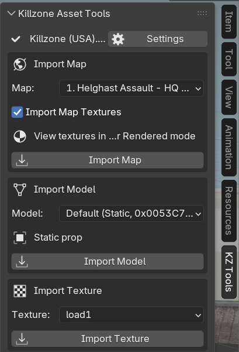
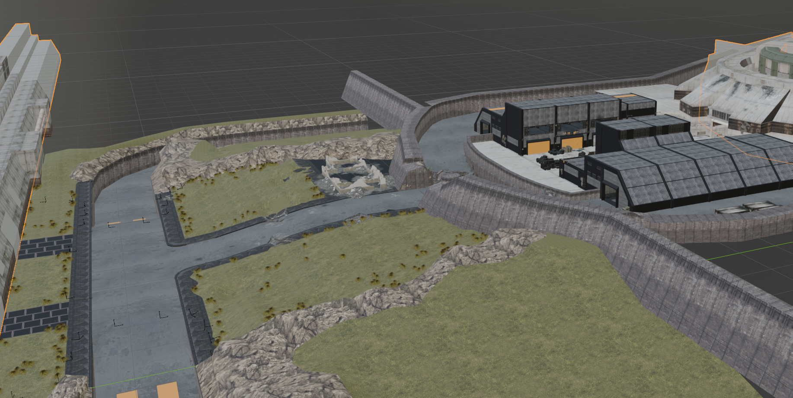
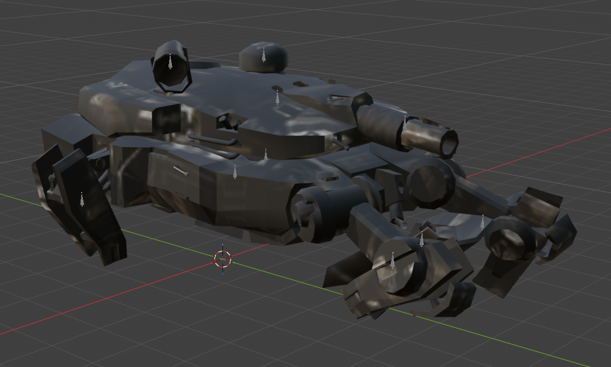
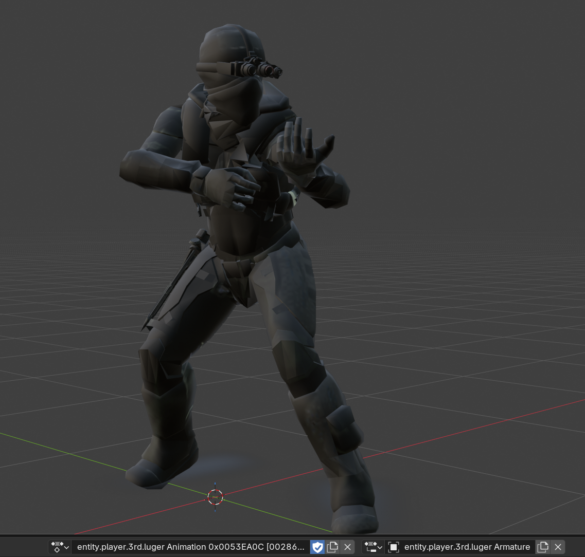

# Killzone Asset Tools for Blender

Killzone Asset Tools is a Blender extension and companion toolkit for
inspecting and importing Killzone assets. It targets **Blender 5.2.x** and
uses strict, bounded parsers so that measured behavior stays separate from
unverified assumptions.

Native game formats are currently **read-only**. The project can import proven
data paths and preserve source metadata, but it does not encode edited Blender
content back into native Killzone resources.

For format layouts, corpus counts, decoding equations, runtime evidence, and
known unknowns, see the
[technical reference](./docs/technical-reference.md).

## Highlights

- Cache importable native assets from an authorized ISO or DAT directory.
- Import naturally ordered maps with optional packed textures.
- Import standalone static props and skinned models with Skeletons.
- Bake compatible model-local or explicitly selected shared animations.
- Preserve unchanged interchange meshes and attached original blobs
  byte-for-byte.
- Inspect authorized Killzone disc images and native container catalogs
  without modifying them.
- Import proven native texture formats and pack decoded images into Blender.
- Import the experimental default-LOD static render graph from native levels.
- Import standalone skinned characters with source-order Skeletons, rigid
  vertex assignments, materials, and decoded textures.
- Decode variant-5 animation banks and bake clips as persistent Blender 5.2
  slotted Actions.
- Represent unresolved materials, palettes, transforms, and runtime-only
  systems explicitly instead of inventing conversions.
- Validate parsers with pure-Python tests and an actual headless Blender smoke
  test.

## Screenshots

### KZ Tools workflow

The sidebar provides cached selectors for maps, static and skinned models, and
standalone textures.

<p align="center">
  
</p>

### Imported map

`1. Helghast Assault - HQ Grounds` imported with packed native textures and
bounded visible material previews:



### Models and animations

| Imported hovertank | Player 3rd Luger animation |
|---|---|
|  |  |

## Support at a glance

| Area | Status |
|---|---|
| Killzone Asset Bundle import/export | Implemented; UI temporarily hidden |
| Static meshes, normals, UVs, colors, and material slots | Supported |
| ISO/container discovery and catalog reporting | Read-only |
| Native background and embedded textures | Experimental, read-only |
| Native static level geometry | Experimental default-LOD import |
| Native skinned characters and Skeletons | Experimental standalone import |
| Native animation Actions | Experimental variant-5 import |
| Native materials | Structural and diagnostic previews |
| Runtime decals | Policies preserved; projected geometry not reconstructed |
| Collision, gameplay entities, AI, and effects | Not imported |
| Edited native resource export | Not supported |

The project-owned `.kzm` interchange format is not a native Killzone format.
Its coordinate convention is right-handed, Z-up, -Y-forward, in meters.

## Requirements

- Blender **5.2.x**
- Python for the standalone inspection tools
- An authorized Killzone disc image or extracted native containers for native
  asset workflows

No game data is included in this repository. Disc images, DAT containers,
generated packages, and probe output are excluded by
[`.gitignore`](./.gitignore).

## Install in Blender

The current add-on version is **0.13.0**.

Build the extension package from the repository root:

```powershell
New-Item -ItemType Directory -Force '.\dist' | Out-Null
& 'D:\Blender Foundation\Blender 5.2\blender.exe' `
  --command extension build `
  --source-dir '.\io_scene_killzone' `
  --output-dir '.\dist'
```

In Blender, open **Edit > Preferences > Extensions**, choose
**Install from Disk**, and select the generated ZIP. Operators are available
in the 3D View sidebar under **KZ Tools**.

## Usage overview

### Asset Bundles

Version 1 Killzone Asset Bundle parsing remains implemented, but its Blender
import/export controls are temporarily hidden while that workflow is refined.
A bundle contains a manifest, project-owned `.kzm` meshes, material metadata,
and optional preserved original blobs.

See [Bundle layout](./docs/technical-reference.md#bundle-layout) for the
on-disk structure and integrity rules.

### Native assets

Configure native assets once:

1. Open **Edit > Preferences**, expand **Killzone Asset Tools**, and choose an
   authorized Killzone ISO or a directory containing `FILES.DAT` and
   `FILES01-04.DAT`.
2. Select **Scan / Rescan Importable Assets**. The resulting map, texture,
   model, and animation-bank catalog is cached in the add-on preferences and
   reused across Blender files.
3. Open **3D View > Sidebar > KZ Tools** to import from the cached selectors.

**Import Map** lists campaign maps by retail chapter and area, followed by
multiplayer maps, using numeric rather than lexical level ordering. **Import
Map Textures** is enabled by default; disable it for a geometry-only import
that skips native texture and material decoding. Enabled imports pack decoded
images and connect bounded visible material previews; unsupported complex
multi-pass shaders remain clearly diagnostic instead of being fabricated.
Diagnostic `ALPHAADD` previews use serialized Native V4-8 modulation when it
is present, including materials whose provider texture is intentionally white.
Use Blender's **Material Preview** or **Rendered** viewport shading to see
those textures; **Solid** shading does not display the shader images.

**Import Model** combines standalone static props and supported skinned model
roots. Skinned models include their source-order Skeleton and rigid vertex
assignments. Cached clips from the model Core and one optional shared bank are
shown as a multi-select checklist. All clips remain selected by default to
preserve the earlier behavior; use **None** and select only the Actions needed
for a faster import. Only clips that cover the model's complete Skeleton are
admitted.

The default **Optimized Bulk FCurves** writer creates Blender 5.2 layered
Actions with vectorized keyframes and reduces exactly constant channels to one
key. **Legacy Keyframe Insert** keeps the original known-working writer
available. Automatic fallback to that legacy writer is enabled by default if
the optimized Blender-writing stage fails. Native decoding, pose evaluation,
and decomposition validation are shared by both writers. The visible
animation decomposition tolerance defaults to `0.05`.

Version 0.13.0 uses asset-cache schema 2 to store lightweight clip identities
and durations. Run **Scan / Rescan Importable Assets** once after upgrading.

For example, `entity.player.3rd.luger.core` contains 174 compatible clips. On
the validation machine, importing all of them improved from an estimated
46 seconds with the legacy writer to about 18.5 seconds with the optimized
writer. Selecting one clip creates one Action and avoids parsing or baking the
other 173 clips.

**Import Texture** retains access to supported standalone native textures.

Changing the ISO or DAT directory invalidates the active cache until
**Scan / Rescan Importable Assets** is run again.

### Material preview troubleshooting

Native textures can be provider data rather than the final visible color. For
example, `level.1.hqgrounds` Material `0x0055A49C` references 128x128
`INDEX_8` Texture `0x0055A886`, whose decoded pixels are uniformly opaque
white. Its authored preview tint comes from serialized Native V4-8 vertex
color `(37, 36, 32, 128)`.

For any material that looks incorrect, inspect these custom properties
on the Blender Material:

- `killzone_core_local_token`
- `killzone_preview_mode`
- `killzone_shader_status`
- `killzone_preview_v4_8_modulation`

The companion tools in [`tools/`](./tools/) also read from an authorized ISO
or extracted DAT directory. They cover catalog inspection, Core scanning,
textures, static levels, skinned characters, animation banks, and bounded
diagnostics.

Common entry points include:

- [`kz_asset_probe.py`](./tools/kz_asset_probe.py) for disc/container inventory
- [`kz_catalog.py`](./tools/kz_catalog.py) for native catalog reporting
- [`kz_core_scan.py`](./tools/kz_core_scan.py) for Core inventory
- [`kz_level_preview.py`](./tools/kz_level_preview.py) for experimental static
  level imports
- [`kz_skinned_preview.py`](./tools/kz_skinned_preview.py) for standalone
  characters and animation Actions

Exact commands, selection rules, validation policies, and report fields are
documented in the [technical reference](./docs/technical-reference.md).

## Important boundaries

- Native parsers and importers are read-only.
- Native material graphs are inspectable diagnostics, not a claim of exact
  final game shading.
- Generated coordinate routes, some transforms, dynamic palettes, and other
  runtime state remain explicitly unresolved.
- Static level imports do not include collision, skinned actors, paths, AI,
  entities, effects, lights, gameplay behavior, or higher-LOD selection.
- Animation import preserves clip identity, binding diagnostics, timing, and
  decomposition residuals. Blender channel approximations are rejected unless
  the caller explicitly permits a measured tolerance.
- Native export remains blocked until unchanged serialization, edited-data
  encoding, archive repacking, and game-side acceptance are independently
  demonstrated.

## Repository layout

```text
io_scene_killzone/       Blender extension and core parsers
tools/                   Standalone inspection and import utilities
tests/                   Pure-Python and Blender smoke tests
docs/technical-reference.md
                         Format evidence and implementation contracts
docs/architecture.md     Implemented architecture and evidence-gated roadmap
```

## Validate

Run the pure-Python format and safety tests:

```powershell
python -m unittest discover -s tests -p 'test_*.py'
```

Run the Blender import/edit/export smoke test:

```powershell
& 'D:\Blender Foundation\Blender 5.2\blender.exe' `
  --background --factory-startup `
  --python '.\tests\blender_smoke.py'
```

The smoke fixture is generated procedurally and contains no game data.

## Documentation

- [Technical reference](./docs/technical-reference.md) - native formats,
  evidence, equations, diagnostics, and unresolved boundaries
- [Architecture](./docs/architecture.md) - implemented module boundaries,
  data flows, decisions, and evidence-gated next steps

## License

The extension is distributed under `GPL-3.0-or-later`.
